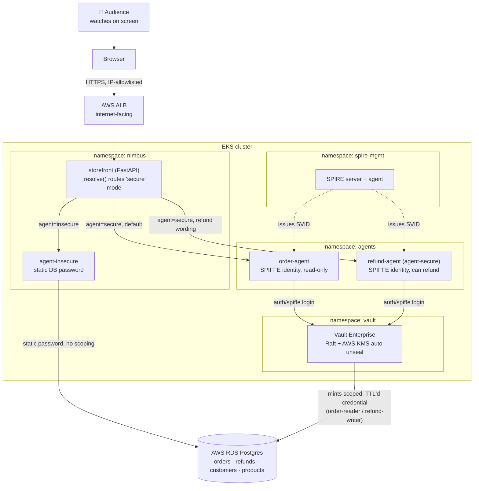

# agentic-security-runtime-demo

A live-runnable demo for the talk **"No Standing Access for AI Agents with Vault Runtime
Security and SPIFFE."** A small shopping site, **Mahi Stores**, has an AI customer-support
agent that issues refunds. Two versions of that agent run side by side:

- **`agent-insecure`** -- a static, long-lived database password. Standing access: the
  credential belongs to the app, not the task, and has no idea who's asking.
- **`agent-secure`** -- a real SPIFFE workload identity (SPIRE-issued) exchanged for a Vault
  token via the native `auth/spiffe` method, which mints a database credential scoped to one
  role with a 3-minute TTL, used once, then dead on command.

A third beat shows a human approving a large refund via **real Vault OBO (on-behalf-of)
delegation** -- RFC 8693 token exchange + RFC 9396 RAR, not metadata on a child token. The
agent exchanges the approver's cached identity for a fresh, RAR-scoped Bearer token
(`authorization_details` naming exactly the one role/capability this request needs), and Vault
checks it against the intersection of the agent's ceiling policy, the approver's own policy,
and that claim -- see `app/agent/src/agent/obo.py` and `docs/RUNBOOK.md`'s "OBO -- what was
actually tested" for the empirical record. The storefront's **Agentic Workflow** panel -- a live,
dark stage-column diagram (Identity → Authenticate → Approval → Credential → Execute), driven
entirely by the agents' own real events -- shows both registered agents side by side with
their real Vault Agent Registry ceiling policy, and correlates the approver's identity and the
Vault lease in the Credential stage's detail drawer. (Vault's own audit log carries the
identical fields -- enabled and verified by `scripts/03-verify.sh`, but presenter-only, not
shown on stage.)

A fourth beat demonstrates the real **Vault Agentic IAM** feature this repo is named after
(Agent Registry + RAR) -- no longer gated behind a hypothetical license: this stack runs
self-managed Vault Enterprise on EKS with a real trial license, so `terraform/agentic-iam.tf`
applies unconditionally. See "Agentic IAM" below and `docs/RUNBOOK.md`.

The demo is **presenter-driven**: the audience watches a live, publicly reachable website on
screen (storefront + chatbot + real refund flow), not a terminal. They do not open the URL
themselves.

## Architecture



`order-agent` and `refund-agent` are genuinely separate SPIFFE identities and Vault-scoped DB
roles -- not one identity with a UI toggle. The storefront decides which one handles a "secure"
request automatically (least-privilege by default); see "Agentic IAM" below.

## Storefront UI

Two tabs, switched in the topbar:

- **Shop** (default) -- a clean consumer storefront: a 14-item product catalog with real photos
  (`app/storefront/static/images/`, sourced from Wikimedia Commons and bundled locally --
  nothing hotlinked, so nothing can fail to load on venue Wi-Fi), including four Apple-branded
  items (iPhone 18 Pro, MacBook Air, AirPods Pro, Apple Watch -- demo catalog labels, not
  verified real current products; see `images/ATTRIBUTION.md`). A floating **💬 AI Assistant**
  chat widget (with its own "Chatting as" customer picker and "Support agent" mode picker, both
  kept in sync with the Agentic Workflow tab's) is collapsed to a launcher by default. Clicking a
  suggestion chip ("Request a refund" / "Check my order status") without an order number asks
  for one via a real follow-up turn, not a canned error. No other demo chrome visible -- a real
  shopper never sees a security panel.
- **Agentic Workflow** -- the presenter/demo view: the "Shopping as" and "Support agent" controls
  (switch customer, switch insecure/secure mode), an **Order History** table (who ordered what,
  with the order number -- reuses `/api/orders`, for picking a valid customer/order combo live),
  and a live, dark stage-column diagram (Identity → Authenticate → Approval → Credential →
  Execute). Identity shows **both** registered agents (`order-agent`, `refund-agent`) at once --
  kept live via `/api/state` polling, not just whichever handled the last turn -- each tagged
  with its real Agent Registry ceiling policy. Real SVG connector lines link every card to the
  next (both agents converge into Authenticate), a dashed bypass arc appears when a refund skips
  Approval (under the £100 threshold), and a dark terminal-style event stream replaces the old
  Activity log.

The chat widget talks to whichever backend `app/storefront/main.py`'s `_resolve()` routes to --
see "Agentic IAM" below for what that means once two agents exist.

## The real thing: AWS EKS + self-managed Vault Enterprise + SPIRE

**Prerequisites:**
1. A Vault Enterprise trial license, stored in AWS Secrets Manager:
   ```bash
   aws secretsmanager create-secret --name agentic-sec-demo/vault-license \
     --secret-string "$(cat vault.hclic)"
   ```
2. `app/db/04_storefront_role.sql` and `app/db/03_legacy_role.sql` applied once by hand against
   RDS (after the first `terraform apply`'s RDS instance exists).

```bash
export IMAGE_REGISTRY=<your ECR repo>
export LEGACY_DB_PASSWORD=<see app/db/03_legacy_role.sql>
export STOREFRONT_DB_PASSWORD=<see app/db/04_storefront_role.sql>
bash scripts/01-provision.sh
```

**Read `docs/RUNBOOK.md` before running this.** `scripts/03-verify.sh` and
`scripts/04-verify-agentic-iam.sh` are go/no-go gates; don't build a rehearsal on top of a
stack that hasn't passed them.

**This stack costs real money while it's up** -- see `docs/RUNBOOK.md`'s cost math (well under
the HCP-based version's ~$1.80/hr). Run `scripts/destroy.sh` after every rehearsal -- it
explicitly checks for orphaned load balancers and EBS volumes, the two new leak modes this
migration introduced.

## Agentic IAM (Agent Registry + RAR)

With a real Enterprise license on a real cluster, `terraform/agentic-iam.tf` registers **two**
agents and applies unconditionally as part of `scripts/01-provision.sh`:

- **`order-agent`** -- read-only, cannot issue refunds (PostgreSQL has no grant for it to).
- **`refund-agent`** -- can look up orders and issue refunds.

The customer never picks between them; `app/storefront/main.py` routes "secure" mode to
whichever one fits the request automatically, defaulting to the read-only one. See
`scripts/demo-beat4-agentic-iam.sh` for the live version of the contrast.

To re-run just the verification, the RAR empirical test, and a ceiling-misconfiguration probe
on an existing stack:

```bash
bash scripts/04-verify-agentic-iam.sh
```

That script confirms both Agent Registry registrations and the OAuth resource server path are
reachable, then runs two real experiments -- both now empirically answered on a real cluster,
not open questions:

- A bare Bearer JWT carrying `authorization_details`, presented directly to a KV path outside
  any real OAuth/OBO exchange, is refused identically (HTTP 403) whether its claimed
  path/capability are right or wrong. RAR isn't enforced on this path without a real OBO flow
  -- confirmed to be because that probe token was missing the claims (`act`, `jti`) a real OBO
  token carries, not because RAR doesn't work; see `docs/RUNBOOK.md`'s amendment to this
  finding.
- Deliberately widening `order-agent`'s real ACL policy to also grant `refund-writer` read
  access, then asking for it with a normal `auth/spiffe`-issued token (not a bare Bearer JWT),
  **succeeds** -- the Agent Registry ceiling did not block it. The ceiling constrains an
  OBO/RAR-delegated request, not an agent's own ordinary token -- and beat 3's real refund
  approval is exactly such a delegated request; see below.

The Agentic Workflow's **"⛰ Probe this agent's ceiling"** button makes that second finding
clickable live on stage, for either agent: it asks the picked agent's own real token to attempt
its one escalation-target role right now (`order-agent` -> `refund-writer`, more money
privilege; `refund-agent` -> `customer-pii-reader`, PII exposure -- it already legitimately
holds `refund-writer`, so there's no higher-money role to test it against), with no new Vault
grant added by the click itself -- denied normally, and only succeeding (then self-revoking)
during a deliberate live policy-widen run from the presenter's terminal
(`scripts/demo-beat4-ceiling.sh widen order|refund`). See `docs/RUNBOOK.md`'s "Agentic IAM"
section for the full mechanism. **Real on-behalf-of delegation is implemented** (beat 3,
`app/agent/src/agent/obo.py`) -- the one thing not real about it is the signer: an IBM Verify
tenant was checked and its documented token-exchange grant never mentions RAR at all, so this
repo signs the delegated token itself with a throwaway key rather than calling a real IdP. What
Vault enforces on receipt is identical either way; see `docs/RUNBOOK.md`'s "OBO -- what was
actually tested" for the full empirical record.

## Layout

| Path | What's there |
|---|---|
| `app/storefront/` | FastAPI storefront: Shop/Agentic Workflow tabs, catalog with local product photos, floating AI Assistant chat widget, the live Agentic Workflow panel + order history |
| `app/agent/` | The support agent, as one image running in two modes (`AGENT_MODE=insecure\|secure`); `obo.py` signs real OBO delegation tokens for the secure mode's approval beat |
| `app/db/` | Schema + seed data + the deliberately-bad `nimbus_app_legacy` role + the storefront's own least-privilege role |
| `terraform/` | AWS (VPC/EKS/RDS/KMS) + self-managed Vault Enterprise (vault-helm) + AWS Load Balancer Controller + Vault config + Agentic IAM + `obo.tf` (the OBO spike's human entity/policy/resource-server profile) |
| `k8s_manifests/` | SPIRE Helm values, storefront/agent Deployments (`agent-insecure`, `agent-secure` = refund-agent, `order-agent`), `agent-secure`'s OBO signing-key Secret, the public storefront Ingress |
| `scripts/` | Provisioning, Vault init, the go/no-go gates, the four demo beats, `presenter-login.sh`, `05-verify-obo.sh`, reset, teardown |
| `docs/RUNBOOK.md` | Provisioning order, self-managed-Vault constraints, confirmed gotchas, cost |
| `docs/TALK-NOTES.md` | The four-beat narrative script, stagecraft notes, prior art to cite |

## Open risks

- The storefront exposes unauthenticated `/api/admin/reset`, `/api/admin/revoke`,
  `/api/admin/ceiling-test`, and `/api/admin/human-token` endpoints (all buttons/forms in the
  UI, or `scripts/presenter-login.sh`). The demo relies on the ALB's security-group IP
  allowlist, not application auth, to keep them presenter-only -- see `docs/RUNBOOK.md`.
  `/api/admin/human-token`'s GET half returns status only, never the cached credential itself.
- `scripts/01-provision.sh` has now been run successfully end-to-end against real AWS -- see
  `docs/RUNBOOK.md`'s "Confirmed gotchas from the first real provisioning run" for the real bugs
  that surfaced and were fixed (EKS addon ordering, SPIRE chart compatibility, a JWKS bundle
  that silently broke every `auth/spiffe` login, and others). Read that section before the next
  from-scratch provision.
- In-cluster Vault traffic is unencrypted (`global.tlsDisable = true`) -- correct for this demo,
  not for production. See `docs/TALK-NOTES.md`'s "what's not real here."
