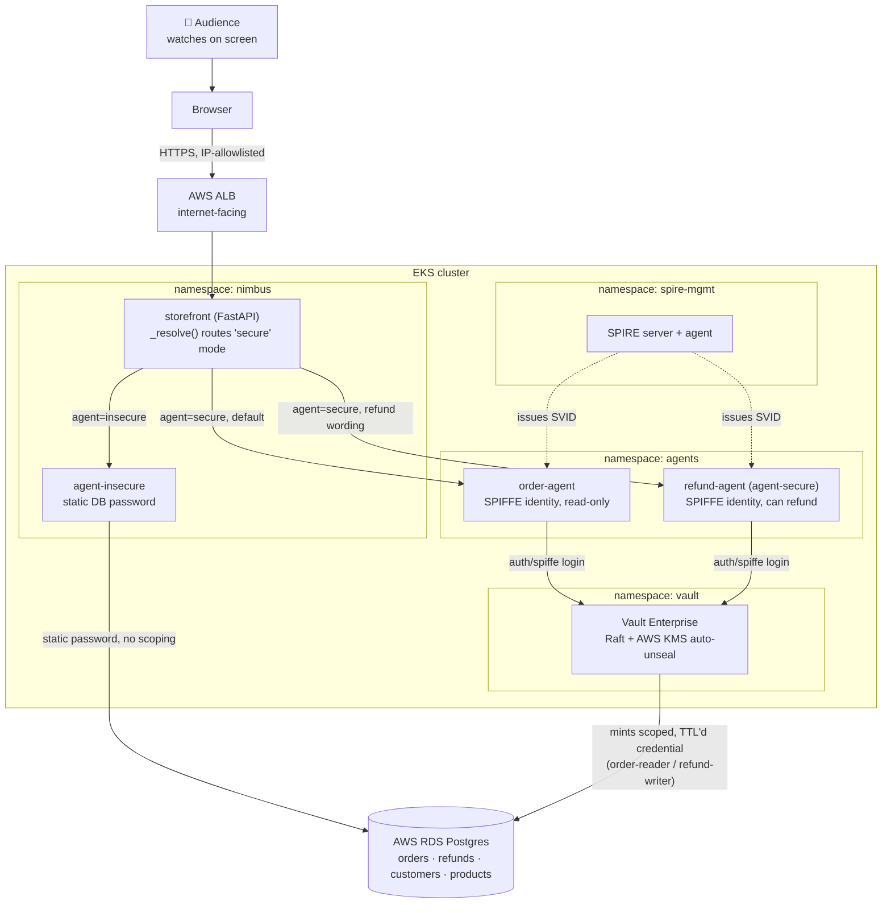

# agentic-security-runtime-demo

A live-runnable demo for the talk **"No Standing Access for AI Agents with Vault Runtime
Security and SPIFFE."** A small shopping site, **Mahi Stores**, has an AI customer-support
agent that issues refunds. Two versions of that agent run side by side:

- **`agent-insecure`** -- a static, long-lived database password. Standing access: the
  credential belongs to the app, not the task, and has no idea who's asking.
- **`agent-secure`** -- a real SPIFFE workload identity (SPIRE-issued) exchanged for a Vault
  token via the native `auth/spiffe` method, which mints a database credential scoped to one
  role with a 3-minute TTL, used once, then dead on command.

A third beat shows a human approving a large refund; the storefront's **Security Flow** panel
-- a live, 6-stage view of Identity → Auth → Credential → Approval → Execute → Revoke, driven
by the agent's own real events -- correlates the approver's name, the workload's SPIFFE ID, and
the Vault lease in the Approval stage's detail drawer. (Vault's own audit log carries the
identical three fields -- enabled and verified by `scripts/03-verify.sh`, but presenter-only,
not shown on stage.)

A fourth beat demonstrates the real **Vault Agentic IAM** feature this repo is named after
(Agent Registry + RAR) -- no longer gated behind a hypothetical license: this stack runs
self-managed Vault Enterprise on EKS with a real trial license, so `terraform/agentic-iam.tf`
applies unconditionally. See "Agentic IAM" below and `docs/RUNBOOK.md`.

The demo is **presenter-driven**: the audience watches a live, publicly reachable website on
screen (storefront + chatbot + real refund flow), not a terminal. They do not open the URL
themselves.

## Architecture



`order-agent` and `refund-agent` are genuinely separate SPIFFE identities and Vault-scoped DB
roles -- not one identity with a UI toggle. The storefront decides which one handles a "secure"
request automatically (least-privilege by default); see "Agentic IAM" below.

## Storefront UI

Two tabs, switched in the topbar:

- **Shop** (default) -- a clean consumer storefront: a product catalog with real photos
  (`app/storefront/static/images/`, sourced from Wikimedia Commons and bundled locally --
  nothing hotlinked, so nothing can fail to load on venue Wi-Fi) and a floating **💬 AI
  Assistant** chat widget, collapsed to a launcher by default. No demo chrome visible -- a real
  shopper never sees a customer picker or a security panel.
- **Security Flow** -- the presenter/demo view: the "Shopping as" and "Support agent" controls
  (switch customer, switch insecure/secure mode) plus the live 6-stage Security Flow panel
  (Identity → Auth → Credential → Approval → Execute → Revoke) and the Activity log.

The chat widget talks to whichever backend `app/storefront/main.py`'s `_resolve()` routes to --
see "Agentic IAM" below for what that means once two agents exist.

## The real thing: AWS EKS + self-managed Vault Enterprise + SPIRE

**Prerequisites:**
1. A Vault Enterprise trial license, stored in AWS Secrets Manager:
   ```bash
   aws secretsmanager create-secret --name agentic-sec-demo/vault-license \
     --secret-string "$(cat vault.hclic)"
   ```
2. `app/db/04_storefront_role.sql` and `app/db/03_legacy_role.sql` applied once by hand against
   RDS (after the first `terraform apply`'s RDS instance exists).

```bash
export IMAGE_REGISTRY=<your ECR repo>
export LEGACY_DB_PASSWORD=<see app/db/03_legacy_role.sql>
export STOREFRONT_DB_PASSWORD=<see app/db/04_storefront_role.sql>
bash scripts/01-provision.sh
```

**Read `docs/RUNBOOK.md` before running this.** `scripts/03-verify.sh` and
`scripts/04-verify-agentic-iam.sh` are go/no-go gates; don't build a rehearsal on top of a
stack that hasn't passed them.

**This stack costs real money while it's up** -- see `docs/RUNBOOK.md`'s cost math (well under
the HCP-based version's ~$1.80/hr). Run `scripts/destroy.sh` after every rehearsal -- it
explicitly checks for orphaned load balancers and EBS volumes, the two new leak modes this
migration introduced.

## Agentic IAM (Agent Registry + RAR)

With a real Enterprise license on a real cluster, `terraform/agentic-iam.tf` registers **two**
agents and applies unconditionally as part of `scripts/01-provision.sh`:

- **`order-agent`** -- read-only, cannot issue refunds (PostgreSQL has no grant for it to).
- **`refund-agent`** -- can look up orders and issue refunds.

The customer never picks between them; `app/storefront/main.py` routes "secure" mode to
whichever one fits the request automatically, defaulting to the read-only one. See
`scripts/demo-beat4-agentic-iam.sh` for the live version of the contrast.

To re-run just the verification, the RAR empirical test, and a ceiling-misconfiguration probe
on an existing stack:

```bash
bash scripts/04-verify-agentic-iam.sh
```

That script confirms both Agent Registry registrations and the OAuth resource server path are
reachable, then runs two real experiments: presents a bare Bearer JWT carrying
`authorization_details` directly to a KV path, with two deliberately-wrong variants (wrong
path, wrong capability), to find out empirically whether RAR is enforced outside a real
OAuth/OBO exchange; and deliberately widens `order-agent`'s real policy to see whether the
Agent Registry ceiling caps a normal token independent of RAR/OBO -- neither is something
HashiCorp's docs confirm either way. See `docs/RUNBOOK.md`'s "Agentic IAM" section for what's
confirmed, and why real on-behalf-of
delegation (a different, human-approval-linking piece) isn't attempted at all.

## Layout

| Path | What's there |
|---|---|
| `app/storefront/` | FastAPI storefront: Shop/Security Flow tabs, catalog with local product photos, floating AI Assistant chat widget, the live Security Flow panel |
| `app/agent/` | The support agent, as one image running in two modes (`AGENT_MODE=insecure\|secure`) |
| `app/db/` | Schema + seed data + the deliberately-bad `nimbus_app_legacy` role + the storefront's own least-privilege role |
| `terraform/` | AWS (VPC/EKS/RDS/KMS) + self-managed Vault Enterprise (vault-helm) + AWS Load Balancer Controller + Vault config + Agentic IAM |
| `k8s_manifests/` | SPIRE Helm values, storefront/agent Deployments (`agent-insecure`, `agent-secure` = refund-agent, `order-agent`), the public storefront Ingress |
| `scripts/` | Provisioning, Vault init, the go/no-go gates, the four demo beats, reset, teardown |
| `docs/RUNBOOK.md` | Provisioning order, self-managed-Vault constraints, confirmed gotchas, cost |
| `docs/TALK-NOTES.md` | The four-beat narrative script, stagecraft notes, prior art to cite |

## Open risks

- The storefront exposes unauthenticated `/api/admin/reset` and `/api/admin/revoke` endpoints
  (both buttons in the UI). The demo relies on the ALB's security-group IP allowlist, not
  application auth, to keep them presenter-only -- see `docs/RUNBOOK.md`.
- A handful of chart/image specifics (the `vault-helm` version, the `hashicorp/vault-enterprise`
  image tag, the AWS Load Balancer Controller chart version) are pinned to values that were not
  confirmed against a live `helm search repo` at the time this was written -- confirm before the
  first apply; `terraform init` fails loudly and immediately if any are wrong.
- In-cluster Vault traffic is unencrypted (`global.tlsDisable = true`) -- correct for this demo,
  not for production. See `docs/TALK-NOTES.md`'s "what's not real here."
